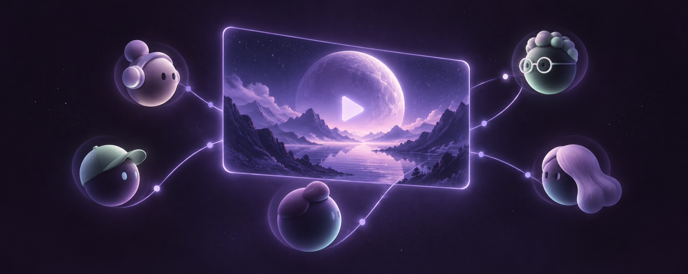
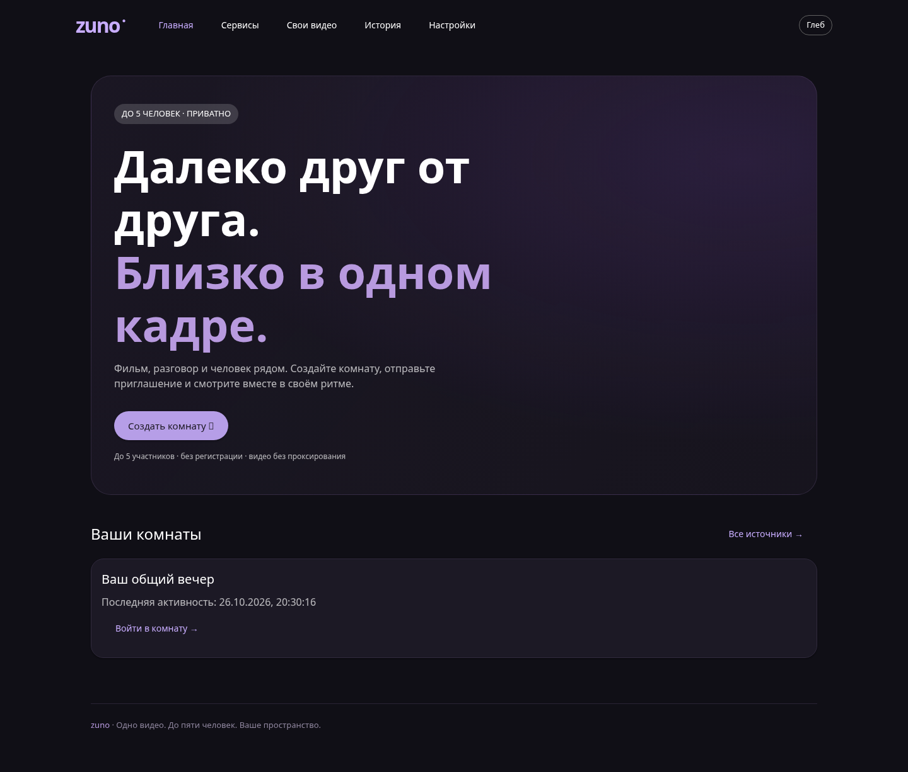
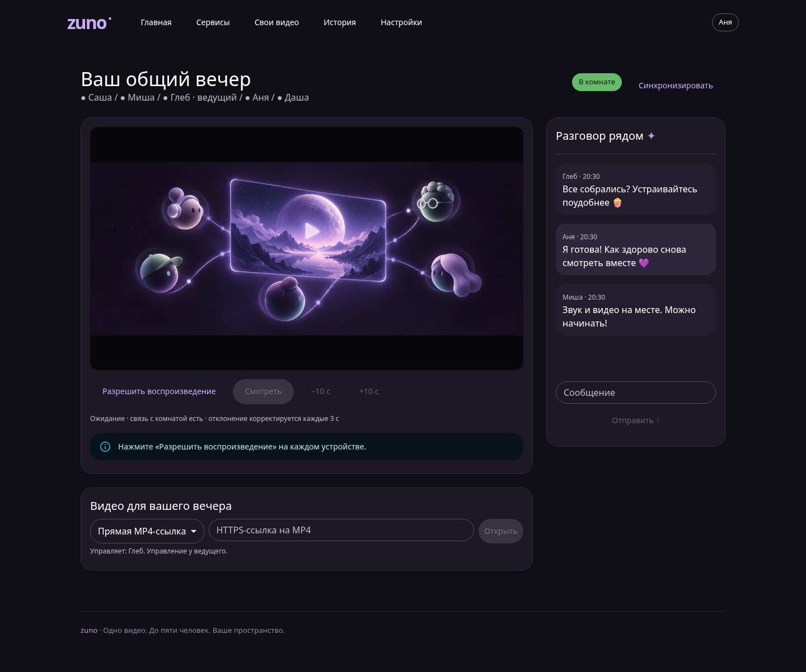
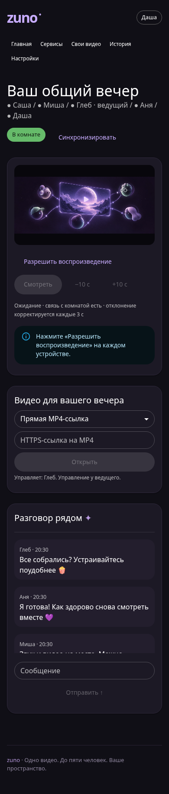

# Zuno



Приватный совместный просмотр для 5 участников


## Как выглядит Zuno

Главная страница:



Комната на компьютере — видео слева, участники и чат рядом:



На телефоне чат располагается под плеером:



Скриншоты сняты в работающем приложении с пятью демонстрационными участниками. Обложка и иллюстрация в демонстрационном видео созданы для проекта с помощью генерации изображений.

## Быстрый запуск разработки

Нужен Node.js **24.19.0** (24 LTS; SQLite встроен, нативные npm-модули не нужны).

```bash
npm ci
cp .env.example .env
node -e "const fs=require('node:fs');const p='.env';fs.writeFileSync(p,fs.readFileSync(p,'utf8').replace(/^SESSION_SECRET=.*$/m,'SESSION_SECRET='+require('node:crypto').randomBytes(32).toString('hex')),{mode:0o600})"
chmod 600 .env
npm run dev
```

Во втором терминале: `npm run dev:web`. Открыть `http://localhost:5173`. URL должен точно совпадать с `PUBLIC_ORIGIN`: не смешивайте localhost и 127.0.0.1. Cookie Secure включается при `NODE_ENV=production`; production требует HTTPS. Vite проксирует API и WebSocket.

```bash
npm run lint
npm run typecheck
npm test
npm run build
npm run test:e2e
npm run release
```

E2E требует ffmpeg (создаёт настоящий H.264/AAC MP4) и Chromium. Локально ожидается `/usr/bin/chromium`; переопределение: `CHROMIUM_PATH=/path/to/chromium npm run test:e2e`. В GitHub Actions устанавливается браузер Playwright. Релиз: `artifacts/zuno-release.tgz`, SHA-256 рядом. Сборка выполняется на машине разработки/CI, **не на VPS**.

## Что реализовано

- Главная, каталог, комнаты, свои видео, личная история, настройки; тёмная/светлая тема, адаптивный интерфейс на Material-компонентах.
- Криптографические приглашения, только хеши токенов в БД; токен в URL fragment не попадает в HTTP access log. Смена ссылки и отзыв всех приглашённых участников. Пять постоянных мест, учитываются и отключившиеся пользователи; ведущий освобождает их отзывом доступа.
- Подписанная HttpOnly SameSite=Strict cookie на год; Secure в production. userId берётся только из проверенной сессии. Смена ника. Аккаунтов и восстановления потерянной cookie пока нет.
- Серверное состояние видео, ревизии и отклонение конфликтующих устаревших команд; управление ведущим или всеми. Snapshot при входе/reconnect, периодическая коррекция отклонений >1.3 с, кнопка синхронизации, подтверждение autoplay пользователем.
- Чат (100 сообщений), ограничения частоты/размеров, текстовый рендер React; личный прогресс каждые 12 с, при pause/source change/disconnect, даты и процент при известной длительности.
- Приватные небольшие MP4: MIME + ftyp, случайные имена, ограничения размера/общей квоты/остатка диска, авторизация каждого GET/Range. Владелец может удалить файл, когда он не выбран в комнатах. Проверка сигнатуры не является полной проверкой кодеков: нужны H.264/AAC. Файлы не исполняются и не транскодируются.
- WAL, версия миграции 1 при старте; проверяемый SQLite online backup; healthcheck, ежедневный systemd timer, ограничения ресурсов процесса.

## Матрица интеграций и границы готовности

| Источник | Реализация | Проверка / ограничение |
|---|---|---|
| Собственные MP4 | HTML5 + защищённый Range | Автотест с реальным H.264/AAC и независимыми браузерами |
| Прямые HTTPS MP4 | HTML5, без скачивания сервером | Протокол общий с файлами; доступность, Range, кодек и срок ссылки проверять на устройствах |
| YouTube | Официальный IFrame Player API; play/pause/seek, ошибки | Реальный внешний playback требует проверки на двух устройствах; регион, autoplay и запрет embed могут мешать |
| RUTUBE / VK | Каталог с отключёнными интеграциями | API-адаптеры и интеграционные проверки ещё не реализованы |
| HLS / другие сайты | Не включены | Позднее, только разрешённое встраивание/API |

Используются нейтральные иконки и текстовые названия. Лицензированные официальные бренд-ассеты не включены: это оставшееся отличие от ТЗ. MUI даёт Material-интерфейс с адаптированной темой; полное соответствие всем токенам Material Design 3 не заявляется. Раскладки виджетов, аккаунты, Android/desktop приложения — дальнейшие этапы.

Автотесты не заменяют проверку HTTPS и мобильных браузеров на реальном сервере. Для пяти зрителей внешнего видео VPS передаёт только команды и чат; при раздаче собственных файлов исходящий трафик VPS умножается на число зрителей. Нагрузочный бюджет RAM/CPU на 1 ГБ нужно измерить после развёртывания.

## Документация

- [Шаблоны развёртывания: systemd и Caddy](deploy/)
- [Протокол, безопасность, структура и проверка](docs/ARCHITECTURE.md)
- [Результаты проверок](docs/VALIDATION.md)

Секреты — только в `.env` или `/etc/zuno.env`, данные — вне каталога релиза. Не меняйте `SESSION_SECRET` при обновлении: иначе cookie всех участников станут недействительными. При утрате cookie ведущего административное восстановление возможно через резервную копию/отдельную процедуру; функция восстановления аккаунта не реализована.
